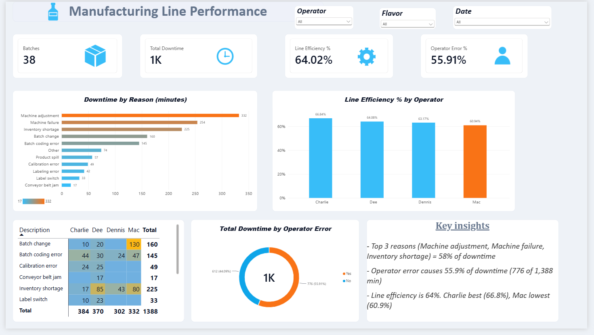

# Manufacturing Line Performance Dashboard (Power BI)

An end-to-end Power BI project analysing the productivity and downtime of a soda bottling line.



## Business problem
A bottling plant wants to know how efficiently its production line runs, where time is being lost, and whether any operators struggle with particular types of errors.

## Questions answered
1. What is the current line efficiency?
2. Are any operators underperforming?
3. What are the leading factors for downtime?
4. How much downtime is caused by operator error?

## Key insights
- **Line efficiency is 64.0%.** Batches take about 36% longer than the ideal time.
- **3 reasons cause 58% of downtime.** Machine adjustment (332 min), Machine failure (254 min) and Inventory shortage (225 min) account for 811 of 1,388 downtime minutes.
- **55.9% of downtime (776 min) is operator-error related**, which points to training and process fixes.
- **Charlie is the most efficient operator (66.8%) and Mac the lowest (60.9%)**, but the gap is small (about 6 points) on only 38 batches, so it should be read as a signal and not a verdict.

## Data
Source: [Maven Analytics, Manufacturing Downtime dataset](https://mavenanalytics.io/data-playground) (public domain).
4 tables: `Line productivity`, `Products`, `Downtime factors`, `Line downtime`.
38 batches, Aug 29 to Sep 3, 2024, 4 operators, 6 products, 12 downtime factors.

## What I did

**Power Query**
- Fixed data types (dates, IDs, times)
- Unpivoted the wide `Line downtime` table (12 factor columns) into `Batch | Factor | Downtime Minutes` (61 rows)
- Calculated batch duration in minutes and handled a batch that runs past midnight (22:55 to 01:05)

**Data model**
- Star schema with 3 one-to-many relationships: Products to Line productivity, Line productivity to Line downtime, Downtime factors to Line downtime

**DAX measures**
```DAX
Batches = COUNT('Line productivity'[Batch])
Total Batch Time = SUM('Line productivity'[Batch Duration (min)])
Min Time = SUMX('Line productivity', RELATED(Products[Min batch time]))
Line Efficiency % = DIVIDE([Min Time], [Total Batch Time])
Total Downtime = SUM('Line downtime'[Downtime Minutes])
Operator Error Downtime = CALCULATE([Total Downtime], 'Downtime factors'[Operator Error] = "Yes")
Operator Error % = DIVIDE([Operator Error Downtime], [Total Downtime])
```
Line efficiency is defined as ideal batch time divided by actual batch time, so 100% means no lost time.

**Dashboard**
- 4 KPI cards, bar chart (downtime by reason), column chart (efficiency by operator), heatmap matrix (operator x reason), donut (operator error vs other), slicers (Operator, Flavor, Date), custom theme

## Validation
Cross-checked the model against an independent calculation: 38 batches, 3,858 actual minutes, 2,470 ideal minutes, 1,388 downtime minutes (3,858 minus 2,470 equals total downtime).

## Files
```
/Manufacturing_Line_Dashboard.pbix
/Manufacturing_Line_Productivity.xlsx
/Clean_Light_Theme.json
/images/dashboard.png
/icons/
```

## Tools
Power BI Desktop, Power Query, DAX

## Author
Your Name | [LinkedIn](https://www.linkedin.com/in/your-profile)
